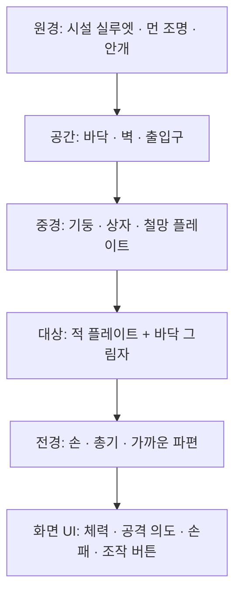

# DEAD HAND: 2.5D 플레이트 그래픽 방향 분석

> **HUD와 직접 조작 업데이트:** 적의 이름·체력 바·행동까지 남은 턴·행동 내용을 같은 패널에 묶는다. 1턴 후는 이번 턴 종료에 실행, 조준은 2턴 후 공격으로 표시한다. 플레이어는 체력 바·방어구 Lv.1·카드로 얻는 임시 방어·에너지를 구분한다. 피해·방어·회복·에너지 등 판단 키워드와 숫자를 확대한다. 같은 카드를 다시 누르면 선택을 해제한다. 공격 카드를 적 위로 끌면 체력 바의 손실 부분과 적용 후 체력·처치 여부를 보여주고, 그 위치에서 놓으면 즉시 사용한다. 적 밖·에너지 부족·취소에서는 사용하지 않는다. 모바일은 가로 손패 스크롤과 구별되는 모서리 손잡이를 제공한다.

> **맥락형 UI 업데이트:** 기본 화면에는 위 HUD의 판단 정보를 둔다. 손패의 비용·이름·핵심 효과는 유지하고, 전체 설명·장갑·계산 과정은 마우스 올리기·포커스·길게 누르기와 선택 시 하나의 상세 패널로 제공한다. 선택 카드의 상세 패널은 손패 바로 위에 배치해 카드 재선택·드래그를 가리지 않는다. 드래그를 시작하면 닫는다. 이전의 큰 상시 정보 패널 제안은 이 방식으로 대체한다.

현재도 Canvas 렌더러에서 원근 투영·가림·그림자를 사용한다. 추가한 공통 광원 처리는 2D 플레이트에 미리 입히는 표현이며, 실시간 3D 법선 조명이나 그림자 맵은 아니다. 얇은 가장자리, 바닥으로 펼친 실루엣 그림자, 발을 고정한 대기 움직임과 드론 부유, 작은 시차를 함께 사용해 무대 안에 세워진 이미지의 인상을 보강했다. 원화의 재질과 포즈 수가 늘어나는 작업은 별도의 아트 제작 단계다.

> **UI 가독성 업데이트:** 전투 정보는 상단 레일, 적 정보는 불투명한 남색 패널, 내 상태·손패·명령은 하단 조작부로 구분한다. 전장 위의 공통 HUD와 사용 버튼을 이동했다. 전체화면 UI는 반응형 크기로 확대하고, 카드 설명은 모바일에서도 14px 이상을 사용한다. 선택 후 예상 효과·비용을 확인하고 사용 버튼으로 확정한다. 공격 카드는 드래그 후 적 위에서 놓아 확정할 수도 있다. 아래의 얕은 입체감보다 정보 위계와 읽기 쉬운 크기를 우선한다.

> **적용 업데이트 — 고정 시점 카드 전투:** 자유 이동·미니맵·시점 회전 입력을 제거했다. 원근을 공유하는 바닥·벽과 로컬 SVG 적·소품·무기 플레이트를 조합하고, 모든 적과 의도를 한 화면에 표시한다. 경로 선택 → 턴제 전투 → 카드 보상 → 철수 또는 다음 경로 선택으로 진행한다. 아래 분석의 이동·조준과 이동 버튼 제안은 이 결정으로 대체한다. 마우스에 따른 미세한 장면 시차는 장식이며 대상·사거리·회피 판정에 영향을 주지 않는다.

구현 파일은 `scene.js`, `assets/field-plates.svg`, `assets/weapon-plate.svg`, `battle.css`다. 원본 레퍼런스에 접근하지 못했다는 조건은 동일하며, 제공된 플레이트 방향을 바탕으로 직접 제작한 아트를 사용했다.

이 문서는 FPS 분위기와 카드 중심 전투를 유지하면서, 2D 이미지를 공간에 세워 놓은 듯한 화면을 만드는 스타일 설계안이다.

레퍼런스 이름은 사용자 설명의 **Slots & Daggers**로 해석했다. 이번 환경에서는 공식 Steam 스토어 요청이 HTTP 403으로 차단되어 원본 화면을 직접 확인하지 못했다. 따라서 아래 내용은 사용자가 지정한 **2D 플레이트의 공간 배치 방식**과 현재 프로토타입 코드에 근거한 적용 제안이다. 레퍼런스의 실제 팔레트, 픽셀 밀도, 재질, 애니메이션 기법을 확인한 사실로 서술하지 않는다.

## 목표 인상

**폐쇄구역을 작은 입체 무대로 구성하고, 그 안에 그려진 적과 소품을 세운다. 플레이어는 무대 앞의 카드를 사용해 전투에 개입한다.**

장면은 공간의 깊이를 전달하고, 개별 사물은 의도적으로 평면 이미지의 성격을 드러낸다. 겹침, 원근, 접지 그림자, 카메라 이동에 따른 시차가 두 표현을 연결한다. 하단 손패는 이 무대를 조작하는 물리적인 패널처럼 보이게 한다.

## 현재 구현에서 출발할 부분

| 현재 코드에서 확인한 요소 | 스타일 전환에 활용할 부분 | 보완할 부분 |
| --- | --- | --- |
| `makeSprite()`가 적을 별도의 2D Canvas에 그림 | 투명 배경 적 이미지를 교체할 자리 | 큰 실루엣, 포즈별 이미지, 재질 묘사 |
| `drawEnemy()`가 위치와 거리에 따라 적 이미지를 투영 | 빌보드와 원근 크기 변화 | 발 위치와 바닥의 연결, 접지 그림자, 가림 처리 일관성 |
| `raycast()`가 벽의 깊이와 적의 가림을 계산 | 기존 공간·충돌·깊이 판단 | 배경 그림과 중경 소품을 활용한 장면 구성 |
| `drawWeapon()`이 화면 앞쪽에 무기를 그림 | 가까운 전경 레이어 | 손·총의 일러스트와 반동 포즈 |
| HTML 카드와 HUD가 Canvas 위에 표시됨 | 모바일 조작과 선명한 한글 표시 | 카드 프레임, 표면 질감, 선택 시 높이 변화 |

이미 적은 2D 이미지를 공간에 투영하는 구조다. 시각적 변화의 중심은 **배경과 전경의 구성, 아트 에셋, 그림자와 재질의 통일**이다.

## 장면 레이어

이 순서는 화면 구성의 설명이다. 실제 월드 오브젝트는 위치에 따라 앞뒤가 바뀌므로 벽·소품·적 사이의 깊이 비교가 필요하다.

| 레이어 | 시각적 역할 | 배치·움직임 규칙 |
| --- | --- | --- |
| 원경 | 공간의 분위기와 거리감 | 낮은 대비와 적은 세부 묘사. 카메라 이동 시 변화가 작음 |
| 바닥·벽 | 공간을 지탱하는 기준 | 바닥은 수평, 벽은 실제 방향에 고정. 원근과 충돌이 일치 |
| 중경 소품 | 장면의 겹침과 규모감 | 앞뒤 거리를 다르게 배치. 상자·문·철망은 의도한 방향을 유지 |
| 적 | 전투의 주된 시선 목표 | 투명 배경 이미지. 발을 바닥에 고정하고 필요에 따라 수평으로 플레이어를 향함 |
| 손·무기 | 1인칭 시점과 타격감 | 화면 가까이에 배치. 사격·피격 시 짧고 명확하게 움직임 |
| 손패·정보 | 카드 판단과 터치 조작 | 텍스트는 선명하게 유지. 중요 수치는 카메라 흔들림에 영향받지 않음 |

모든 플레이트가 카메라를 따라 돌면 공간의 구조가 약해진다. 적은 빌보드로, 벽과 기둥은 고정된 면으로 구분한다. 적의 기본 회전은 수평축 방향을 따른다. 바닥 그림자는 적 이미지와 별도 면으로 취급한다.

## 아트와 UI의 연결

### 형태와 재질

- 적은 큰 머리·상체·무기 실루엣과 명확한 밝기 덩어리로 읽히게 한다. 작은 화면에서 윤곽만 보고 적 종류를 구분할 수 있어야 한다.
- 배경·적·손·카드 프레임의 윤곽선, 명암 단계, 표면 거칠기를 맞춘다. 각 요소의 렌더링 방식이 달라도 하나의 아트 세트로 보이게 한다.
- 카드 프레임은 시설에서 사용하는 작전 카드나 장비 패널로 디자인한다. 한글 설명과 비용 숫자는 질감 위에서도 또렷하게 유지한다.
- 픽셀아트 또는 페인터리 표현의 선택, 픽셀 밀도와 디더링 강도는 레퍼런스 원본을 확인한 뒤 확정한다.

### 색과 밝기: DEAD HAND에 대한 제안

아래 색은 기존 군사 시설 콘셉트를 발전시키기 위한 제안이며, 레퍼런스에서 추출한 팔레트가 아니다.

| 역할 | 제안 색상 | 적용 |
| --- | --- | --- |
| 가장 어두운 바탕 | `#151815` | 화면 외곽, 깊은 그림자 |
| 공간의 기본색 | `#4C5947` | 벽, 군장, 기계 표면 |
| 읽히는 면 | `#D2C9AD` | 카드, 문자, 실루엣의 밝은 부분 |
| 선택·행동 | `#D57846` | 장전 카드, 조준, 사격 반응 |
| 위험·피해 | `#AD483A` | 적 공격 의도, 체력 손실 |

밝기 우선순위는 **선택한 카드·현재 대상 → 다른 적과 손패 → 중경 → 원경**으로 설정한다. 화면 전체에 동일한 녹색 필터나 노이즈를 강하게 적용하면 적과 배경이 뭉개지므로, 레이어별 대비를 따로 조정한다.

### 깊이와 조명

- 적의 발 위치를 이미지의 공통 기준점으로 삼는다. 포즈를 바꿔도 발이 미끄러지거나 높이가 달라지지 않게 한다.
- 발밑에 바닥 원근을 따르는 그림자를 둔다. 가까운 적의 접지 그림자는 뚜렷하고, 공중 드론의 그림자는 떨어진 위치에서 넓고 옅게 표현한다.
- 적 이미지에 그려진 기본 광원 방향과 공간의 대표 광원을 맞춘다. 평면 이미지에 실시간 3D 조명을 강하게 적용하는 작업은 첫 단계의 필수 조건으로 삼지 않는다.
- 먼 오브젝트는 대비와 채도를 줄이고, 가까운 소품은 일부 화면을 가리게 배치한다. 이 가림 관계가 장면의 입체감을 만든다.
- 이동·조준 시 거리별로 다른 화면 이동량이 나타나게 한다. 겹침과 시차로 깊이를 전달한다.

### 카드와 전투 연출

- 대기 손패는 무대 앞의 카드 트레이처럼 정리한다. 선택 카드는 약 10~18px 들어 올리고 얕은 그림자와 테두리로 구분한다.
- 공격 카드 선택 시 목표 적의 실루엣 또는 바닥 표식을 강조한다. 사격 후 카드 사용과 적의 반응이 하나의 행동으로 연결되어 보여야 한다.
- 적은 대기·공격 예고·공격·피격·퇴장의 포즈를 준비한다. 평면 이미지를 짧게 이동·기울이거나 교체해 행동을 표현할 수 있다.
- 공격은 앞으로 짧게 튀어나오는 움직임과 밝기 변화로, 방어는 몸 앞에 겹치는 방패 이미지로, 사망은 바닥을 기준으로 내려앉는 움직임으로 구분한다.
- 카드 효과와 적의 공격 순서는 기존 턴제 규칙과 일치시킨다. 적 공격 예고와 피해 숫자는 빠른 연출 중에도 확인할 수 있어야 한다.

## FPS와 모바일의 조건

FPS 분위기는 플레이어 눈높이, 원근, 손·총기의 전경, 카드 사격 반응으로 유지한다. 전투는 고정 카메라의 턴제로 진행하며 자유 이동은 제공하지 않는다. 평면 적이 회전에 따라 종이처럼 얇아지는 문제는 빌보드나 방향별 이미지로 해결한다. 전경을 크게 가리는 카메라 회전과 흔들림은 카드 판단과 터치 조작을 기준으로 조절한다.

모바일 전투 화면에서는 주 대상의 키가 플레이 영역 높이의 약 30~40%가 되는 구도부터 시험한다. 현재 멀리 있는 작은 적을 찾는 부담을 줄이는 출발점이며, 여러 적을 동시에 보여야 할 때 조정한다.

- 세로 화면: 중앙 전투 무대, 하단 플레이어 HUD·카드 트레이, 우측 배낭·리롤·사용·턴 종료를 배치한다.
- 가로 화면: 전투 무대와 카드 패널을 좌우로 구분한 현재 구성을 활용한다.
- 카드 사용·배낭·리롤·턴 종료의 터치 영역은 최소 44px를 유지한다.
- 카드 한글 설명은 실기기에서 읽을 수 있는 크기로 설계한다. 카드 재질과 원근 효과 때문에 글자가 흐려지지 않게 한다.
- 체력·에너지·남은 적과 카드 선택 상태는 평면 HUD에서 안정적으로 표시한다. 장식용 플레이트와 조작 영역의 경계를 분명히 한다.

## 구현 접근과 우선순위

첫 검증은 기존 Canvas 렌더러에 플레이트 아트와 소품 투영을 추가하는 방식으로 진행한다. 적 투영과 깊이 버퍼를 활용할 수 있고, 게임 로직·모바일 입력과 아트 방향을 분리해 검증하기 쉽다. 카드의 얕은 입체 효과는 HTML/CSS에서 처리할 수 있다.

바닥·벽·적의 복잡한 회전, 다수의 기울어진 면이나 입체 조명이 필요해지면 WebGL의 텍스처 평면 렌더러를 검토한다. WebGL과 게임 설치 요구는 별개다. 웹 배포물에 라이브러리와 에셋을 함께 포함하면 플레이어에게 별도의 설치나 사전 다운로드를 요구하지 않는다.

1. **대표 전투 한 장면:** 배경 1세트, 적 1종, 중경 소품 3종, 손·총기, 카드 프레임을 같은 아트 방향으로 제작한다.
2. **공간 연결:** 기준점, 원근 크기, 접지 그림자, 벽과 소품의 가림을 맞춘다.
3. **상태 연결:** 선택 카드, 대상 강조, 사격, 방어와 피격의 시각 반응을 만든다.
4. **모바일 검증:** 세로·가로, 한글 가독성, 멀티터치와 프레임 유지 상태를 확인한다.
5. **구역 확장:** 검증한 장면 규칙을 다른 적과 구역에 적용한다.

이미지는 직접 제작한 로컬 WebP·PNG·SVG 또는 스프라이트 시트로 관리하고, 반복 디코딩 없이 재사용한다. 배경·적·프레임은 같은 파일에 합치지 않고 교체 가능한 단위로 나눈다.

## 스타일 검증 기준

- 정지 화면에서도 적·중경·원경의 앞뒤 관계가 읽힌다.
- 미세한 시선 변화에는 거리별 시차가 나타나며, 적과 소품이 벽을 뚫고 보이지 않는다.
- 적의 포즈가 바뀌어도 발과 그림자의 위치가 유지된다.
- 무기·적·카드가 같은 질감과 명암 규칙으로 연결된다.
- 한눈에 사용할 카드, 공격 대상, 적의 다음 행동을 찾을 수 있다.
- 모바일에서 글자를 읽고 손패를 넘기며 대상에 카드를 드래그해 사용할 수 있다.
- 대표 모바일 환경에서 기존 30fps 목표를 기준으로 성능을 측정한다.

## 원본 레퍼런스 확인 후 결정할 사항

원본 스크린샷을 확보하면 색·재질·카메라 구도·UI 프레임을 실제 관찰과 적용 제안으로 구분해 보완한다. 특히 픽셀 밀도, 윤곽선 강도, 질감 표현, 슬롯 조작부와 전투 장면의 연결 방식을 확인할 필요가 있다. 레퍼런스의 아트 자산을 게임 배포물에 재사용하는 것은 이 설계에 포함하지 않는다.

## 군수 창고 환경 적용 — 2026-10-25

현대 군사·폐쇄 산업 구역의 첫 적용이다. 콘크리트 회색과 올리브 하단 도장, 녹슨 셔터, 냉색 창문, 주황 비상등, 배관·케이블·탄흔·바닥 얼룩으로 무대를 구성했다. 배경 재질은 구역/크기별 캐시에 한 번 그리고, 평면 적과 소품을 깊이 순서로 합성한다. 기존 자체 SVG 적·무기·소품의 형태는 재사용한다.

이는 타르코프를 연상시키는 환경 분위기를 목표로 한 첫 작업이다. 원본 게임 에셋이나 실제 레퍼런스 분석 자료를 재사용한 작업은 아니며, 사실적인 적·무기 원화로 전부 교체한 단계도 아니다. 카드·HUD는 배경과 분리된 평면 UI로 가독성을 유지한다. 드래그 중에는 올바른 대상만 강조하고 주변을 어둡게 처리한다.

## 메뉴와 기지 배경 적용

`assets/perimeter.svg`는 폐쇄구역 검문소, `assets/safehouse.svg`는 작업대·지도·장비 선반이 있는 기지로 직접 구성했다. 메인메뉴는 검문소 배경과 큰 제목, 기지는 별도의 보관/장비 화면, 설정은 검문소 배경을 흐리게 처리한다. 게임 원본 에셋이나 타르코프 이미지를 재사용하지 않는다. 실제 전투의 고정 시점 2.5D 렌더링과 카드/HUD 대비를 유지한다.
